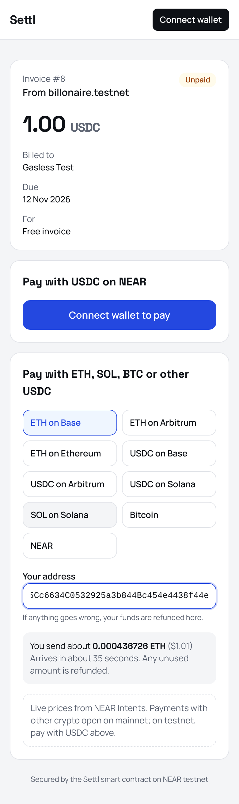
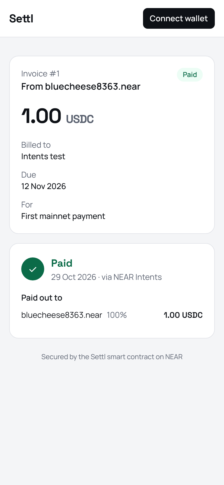
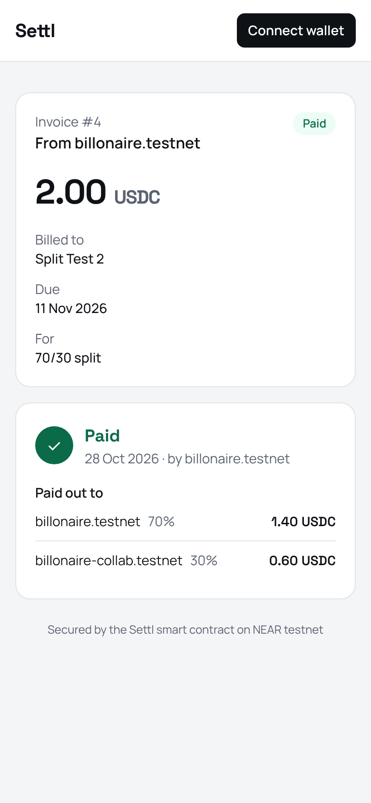
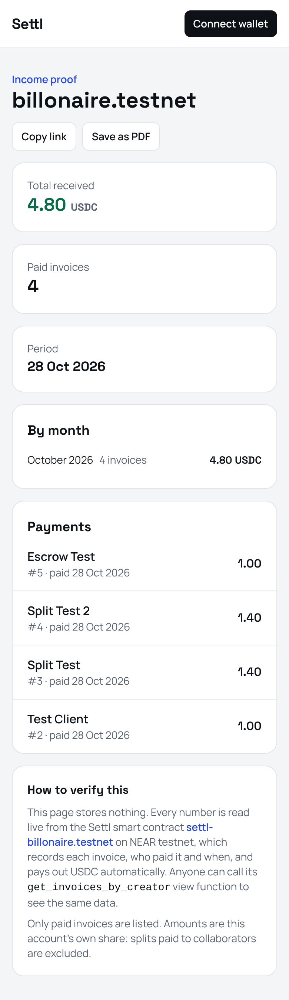
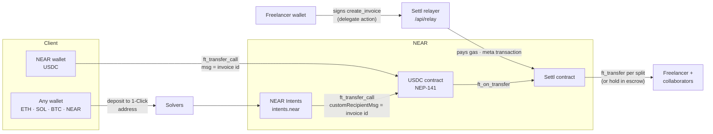

# Settl

**Crypto invoices for freelancers.** Send a link; your client pays with whatever crypto they hold
(USDC, ETH, SOL, BTC, NEAR); you receive USDC on NEAR, split automatically between collaborators,
optionally held in escrow until the client approves the work. Built at NEAR HACKATHON (Oct–Nov 2026).

| | |
|---|---|
| **Live demo (testnet, free test money)** | https://web-seven-ruddy-87.vercel.app |
| **Live app (mainnet, real USDC)** | https://settl-mainnet.vercel.app |
| **Contracts** | [`settl-billonaire.testnet`](https://testnet.nearblocks.io/address/settl-billonaire.testnet) · [`settl-billonaire.near`](https://nearblocks.io/address/settl-billonaire.near) |
| **Tracks** | Real-World Money (main) · Unstoppable DeFi · Open Innovation |

<p>
  
  
  
  
</p>

## The problem
A freelancer paid in crypto has to tell the client which token and chain to use, the client has to
bridge or swap first, and if the work was shared, the freelancer splits the money by hand afterwards.
Proving that income to a landlord or bank means screenshots of wallet history.

## What Settl does
1. **Create an invoice** with an amount in USDC, a due date, up to 5 payout splits, and optional escrow.
2. **Share the link** (copy, WhatsApp or email). The pay page is built for phones.
3. **The client pays** from a NEAR wallet in USDC, *or* with ETH/SOL/BTC/NEAR/USDC from another chain,
   from any wallet, via NEAR Intents. No NEAR account needed.
4. **The contract pays out**: each collaborator gets their share in the same transaction, or the money
   waits in escrow until the client taps "Approve".
5. **Prove your income** with a public `/proof/<account>` page read live from the contract.

Freelancers don't need any NEAR either: invoice creation can be **gasless** (meta transactions + a
sponsored storage pool).

## Try it in 2 minutes (no wallet needed)
| Do | See |
|---|---|
| Open the mainnet [invoice #1](https://settl-mainnet.vercel.app/pay/1) | A **Paid · via NEAR Intents** receipt: a real payment made in NEAR, swapped by solvers and delivered to the contract as exactly 1.00 USDC |
| Open testnet [invoice #4](https://web-seven-ruddy-87.vercel.app/pay/4) | A receipt for a 2.00 USDC invoice paid out **70/30**: 1.40 and 0.60 USDC to two accounts |
| Open testnet [invoice #8](https://web-seven-ruddy-87.vercel.app/pay/8), pick **ETH on Base**, paste any EVM address (e.g. `0x742d35Cc6634C0532925a3b844Bc454e4438f44e`) | A **live price from NEAR Intents** for paying this 1 USDC invoice in ETH (dry-run quote; testnet has no Intents) |
| Open [`/proof/billonaire.testnet`](https://web-seven-ruddy-87.vercel.app/proof/billonaire.testnet) | **4.80 USDC** received from 4 paid invoices, counting only that account's own share of the split ones |

### With a testnet wallet (about 5 minutes)
1. Create a **testnet** account in a NEAR wallet that supports testnet, e.g. [Meteor](https://wallet.meteorwallet.app).
2. Get free testnet USDC at [faucet.circle.com](https://faucet.circle.com) (USDC → NEAR Testnet).
3. On the [testnet demo](https://web-seven-ruddy-87.vercel.app/invoices/new), connect and create an
   invoice. The note under the button says **"Free: Settl pays the network fee and storage"**, and
   Meteor only asks you to *sign*.
4. Open the payment link, pay it, and see the receipt. Try a split, or tick escrow and then approve it.

## How it works


- **One payment path.** Whether the client pays from a NEAR wallet or via Intents, USDC reaches the
  contract through `ft_transfer_call` with the invoice id attached, and `ft_on_transfer` checks the
  token, the invoice and the **exact** amount. Anything wrong panics, and the USDC contract refunds
  automatically.
- **Payouts can't get lost.** Every split payout has a callback. If a transfer fails (e.g. the
  recipient never registered on USDC), the share is kept as a pending balance the recipient can
  `withdraw`, which the dashboard offers.
- **Gasless.** The freelancer's wallet signs a NEP-366 delegate action; the relayer wraps it in a
  transaction and pays gas. Storage comes from the contract's sponsor pool (max 10 invoices per
  account). The relayer only accepts calls to the Settl contract (`create_invoice`, `cancel_invoice`,
  `release_escrow`) with no NEAR attached ([relayPolicy.ts](web/src/lib/relayPolicy.ts)).

## NEAR tech used
| Tech | What it does in Settl |
|---|---|
| **NEAR Intents (1-Click API)** | Pay with ETH, SOL, BTC, NEAR or USDC on Base/Arbitrum/Solana. Settl requests an `EXACT_OUTPUT` quote for the invoice amount with `customRecipientMsg` = the invoice id, so USDC arrives via `ft_transfer_call` and the normal `ft_on_transfer` marks the invoice paid. The server reads the amount from the contract, so the browser can't change it ([quote route](web/src/app/api/intents/quote/route.ts)). NEAR itself is paid by wrapping to wNEAR and sending in one transaction |
| **Meta transactions (NEP-366)** | Gasless invoice creation through Settl's relayer ([relay route](web/src/app/api/relay/route.ts)) |
| **NEP-141 fungible tokens** | USDC payments in, split payouts out, refunds on bad payments |
| **Storage staking** | Each invoice's storage is measured and charged exactly: from the freelancer's deposit (unused part refunded) or from the sponsor pool |
| **Cross-contract calls + callbacks** | Payout transfers with failure handling |
| **Contract upgrades + state migration** | Adding the sponsor pool changed the state layout; `migrate()` rewrote the old state on both networks, keeping every invoice |
| **Named accounts** | Readable contract and user names (`settl-billonaire.near`); receipts and proof pages never shorten them |
| **NEAR Connect** | Wallet selector (Meteor, HOT, Intear, Ledger, …) for signing transactions and delegate actions |

## Verified on-chain
| What | Network | Evidence |
|---|---|---|
| Client pays in NEAR via Intents → 1.00 USDC delivered to the contract → paid out | mainnet | invoice #1: status Paid, payer `intents.near` |
| 70/30 split payout | testnet | invoice #4: 1.40 + 0.60 USDC to two accounts |
| Escrow: pay → held by the contract → client approves → paid out | testnet | invoice #5 |
| Payout to the contract itself fails → share kept, not lost (this found a bug, now fixed) | testnet | invoice #3 |
| Gasless creation from a real Meteor wallet, freelancer's NEAR balance unchanged to the yoctoNEAR | testnet | invoice #8 |
| Relayer refuses other methods, other contracts, NEAR transfers and attached deposits | testnet | [relayPolicy.ts](web/src/lib/relayPolicy.ts) |

## Run it locally
Requirements: Rust (the toolchain in `contract/rust-toolchain.toml` installs automatically),
[`cargo-near`](https://github.com/near/cargo-near), Node.js 22.

```bash
cd contract
cargo test --lib                  # 51 unit tests
cargo test --test payment_flow    # 4 end-to-end tests on a local NEAR sandbox
cargo near build non-reproducible-wasm
```
The end-to-end tests start a local chain, deploy Settl and a mock USDC token, and check real balances
after a split payment, a wrong-amount refund, escrow then release, and a payout to an unregistered
account that is withdrawn later.

```bash
cd web
npm install
cp .env.example .env.local        # defaults point at the testnet deployment
npm run dev                       # http://localhost:3000
```

## Contract API
| Function | Type | Description |
|---|---|---|
| `new(usdc_contract)` | init | Sets which token is accepted as payment |
| `create_invoice(client_name, description, amount, due_date, splits, escrow)` | change, payable | Returns the invoice id. `amount` is in USDC base units (6 decimals: `"25000000"` = 25 USDC). `splits` is a list of `{account_id, basis_points}` adding up to 10,000, max 5. Attach a deposit for storage (excess refunded), or attach nothing to use the sponsor pool |
| `ft_on_transfer(sender_id, amount, msg)` | change | Called by USDC. `msg` is the invoice id (`"12"`) or `{"invoice_id": 12, "payer": "client.near"}`. Exact amount only |
| `release_escrow(invoice_id)` | change | Payer only |
| `cancel_invoice(invoice_id)` | change | Creator only, while unpaid |
| `withdraw()` | change | Sends the caller USDC from payouts that couldn't be delivered |
| `fund_sponsor_pool()` | change, payable | Adds NEAR to the pool that pays storage for deposit-free invoices |
| `migrate()` | private | One-time state upgrade from the previous version |
| `get_invoice(invoice_id)`, `get_invoices_by_creator(account_id, from_index?, limit?)` | view | Invoices (newest first, max 100 per page) |
| `get_pending_balance(account_id)`, `get_sponsor_pool()`, `get_sponsored_invoices_left(account_id)`, `get_usdc_contract()` | view | Balances and settings |

Statuses: `Unpaid` → `Paid`, `Unpaid` → `Escrowed` → `Paid`, or `Unpaid` → `Cancelled`.

## Repository layout
```
contract/          Rust smart contract (cargo-near)
  src/lib.rs         state, create/cancel invoice, views
  src/payment.rs     ft_on_transfer, payouts, escrow release, withdraw
  src/sponsor.rs     sponsor pool for gasless invoices
  src/migrate.rs     state migration
  src/tests/         unit tests
  tests/             end-to-end sandbox tests
  mock-usdc/         minimal NEP-141 token used only by the tests
web/               Next.js app (routes and code map in web/README.md)
docs/screenshots/  screenshots from the live deployments
```

## Known limitations
- **Escrow invoices must be paid from a NEAR wallet.** Releasing escrow needs the payer's NEAR
  signature, which an ETH/BTC payer doesn't have.
- **Gasless is enabled on testnet only.** On mainnet the relayer and sponsor pool would spend real
  NEAR; the code is the same and it's switched on with environment variables.
- **The relayer's spending is capped, not rate-limited.** Each account gets 10 sponsored invoices, but
  a public mainnet relayer would also need rate limiting.
- **Income proof lists invoices an account created**, not payouts it received as someone else's
  collaborator (the contract has no index by recipient).
- **Some Intents routes have minimums** (e.g. BNB Chain had a temporary $1,000 minimum during testing).

## Libraries, templates and AI
- Contract scaffolded with `cargo near new` (official template), then rewritten for Settl.
- `near-sdk`, `near-contract-standards`; tests with `near-sandbox` + `near-api`.
- Web: Next.js 16, Tailwind 4, `@hot-labs/near-connect`, `near-api-js`, `borsh`, `qrcode`; fonts from Fontsource.
- NEAR Intents 1-Click API (no API key; 0.2% fee).
- Built with help from AI coding tools (Claude Code), as allowed by the hackathon rules (Q-005).
- No code from earlier projects.

## Other project by the same builder
Disclosed per the hackathon rules (Q-015): Peter Obisi also built **Heir**, crypto inheritance across chains,
for NEAR HACKATHON: https://github.com/ZSP111/heir. The two projects are independent and share no code.

## License
[MIT](LICENSE)
